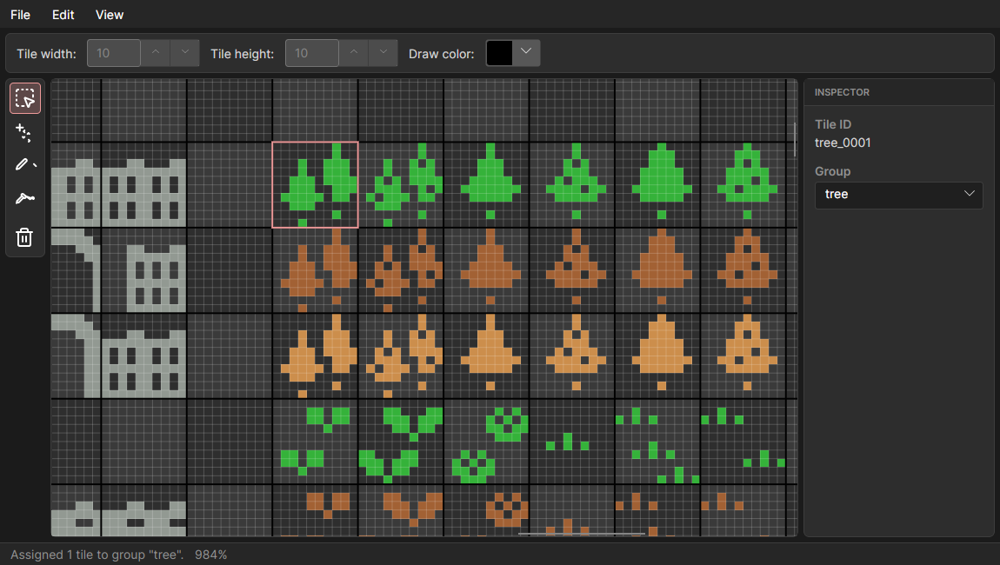

<p align="center">
  
</p>

# Ashlar

Lightweight, local desktop application for managing tilesets and tile maps
for game development. Ashlar detects the tile grid of a tileset image, lets
you edit it, and exports the image together with a `TextureAtlas` XML file
that describes every tile. Tiles can then be laid out on maps that export as
an image and a `Tilemap` XML file.

The name comes from masonry: an *ashlar* is a precisely cut, rectangular
stone block laid in a regular grid, much like the tiles of a tileset.



## Features

### Projects

A project is the working document. It holds any number of tilesets and maps
and is saved as a single self-contained file (`*.ashlar`, embeds the images).
A project explorer on the left lists the project's tilesets and maps.
Double-click an entry (or press Enter) to open it in its own tab; opening an
element that is open already focuses its tab. Every tab keeps its own zoom,
selection, tool, and undo history. Closing a tab (the x, middle click, or
Ctrl+W) never asks for confirmation, because all changes already live in the
project; it only discards that tab's undo history. Right-click an entry for its
actions (add, rename, remove, resize, delete), or press F2 to rename it in
place. The same actions are in the **Tileset** and **Map** menus.

- **File > New project** (Ctrl+N), **Open project...** (Ctrl+Shift+O),
  **Save project** (Ctrl+S), **Save project as...** (Ctrl+Shift+S),
  **Close tab** (Ctrl+W), **Close project** (Ctrl+Shift+W)
- **File > Open tileset...** (Ctrl+O) imports an image as a new tileset
- Images are only ever imported to start a new tileset; the export files are
  outputs and cannot be reopened.
- Projects saved with the older `.ashlar.json` extension need to be renamed
  to `.ashlar` to be opened.

### Tileset editor

Importing an image suggests a tile size, which you confirm or change. Tiles
get stable names such as `dungeon_0001` that do not change when a tile moves.
The tile size can be changed later via **Edit > Change tile size...**.

- Rectangle select (Ctrl+R) and move (M) tools; moving shifts the selected
  tiles by whole cells
- Delete tiles (Del)
- Draw (B) tool for painting single pixels with an RGBA color
- Bucket (G) tool for filling an area with the draw color
- Pipette (I) tool for picking the draw color from the image
- Tile groups
- Undo (Ctrl+Z) and redo (Ctrl+Y or Ctrl+Shift+Z)
- Zoom (**View** menu: Zoom In, Zoom Out, Reset Zoom)

### Map editor

A map is a grid of tiles from exactly one tileset of the project. The tileset
is chosen when the map is created and cannot be changed afterwards. Maps are
created, renamed, deleted, and resized from the project explorer or the **Map**
menu. A tileset has to be added to the project before a map can be created.

- Tile palette on the right showing every tile of the map's tileset
- Draw tool paints the selected palette tile into cells
- Rectangle select and move tools; moving shifts the selected cells
- Delete (Del) clears the selected cells
- Undo (Ctrl+Z) and redo (Ctrl+Y or Ctrl+Shift+Z)
- Cells of a tile are cleared when that tile is deleted from its tileset

### Export

The exports are in the **File** menu and in the **Tileset** and **Map** menus.

**Export XML...** (Ctrl+E on a tileset tab) writes the tileset
metadata in the `TextureAtlas` format, with a texture path of your choice:

```xml
<?xml version="1.0" encoding="utf-8"?>
<TextureAtlas>
    <Texture>dungeon</Texture>
    <Regions>
        <Region name="dungeon_0001" x="0" y="0" width="16" height="16" />
        <Region name="dungeon_0002" x="16" y="0" width="16" height="16" />
        <Region name="dungeon_0003" x="32" y="0" width="16" height="16" />
    </Regions>
</TextureAtlas>
```

**Save image...** writes the edited tileset image as a PNG.

**Export map...** (Ctrl+E with a map selected) writes the selected map as a
`Tilemap` XML file, a PNG image of the map, or both. The XML names the
tileset's tile size and texture path and lists one map row per line. Each
cell is the index of its tile in the tileset's tile list, zero-padded to the
width of the largest index. Empty cells, and cells whose tile no longer
exists, are written as `-1`:

```xml
<?xml version="1.0" encoding="utf-8"?>
<Tilemap>
    <Tileset tileWidth="20" tileHeight="20">images/atlas</Tileset>
    <Tiles>
        00 01 02 -1
        04 05 -1 07
    </Tiles>
</Tilemap>
```

## Tech stack

.NET 8, Avalonia UI (cross-platform: Linux/Windows/macOS), ImageSharp.

## Build & run

```bash
dotnet build
dotnet run --project src/Ashlar.App
dotnet test
```

## License

[PolyForm Noncommercial 1.0.0](LICENSE). In short: free to use, copy,
modify, and distribute for any noncommercial purpose, as long as the
required copyright notice stays attached — **no commercial use or
resale**. There's no warranty of any kind.

Third-party notices (bundled icon assets): see [NOTICE](NOTICE).
